<div align="center">


# GameAnything-Bench

### GameAnything: From Any Inspirations to Playable Game Worlds

**Coding agents take a film scene, a photograph or a page of fiction and build it into a game that already exists, as something you can play.**

[](#citation)
[](https://huggingface.co/spaces/GameAnything/GameAnything)
[](https://huggingface.co/datasets/GameAnything/GameAnything-Bench)
[](LICENSE)
[](https://www.python.org/)

🎮 The GameAnything Opensource Toolkit: **[AetherLabsAI/GameAnything](https://github.com/AetherLabsAI/GameAnything)**

</div>

<p align="center">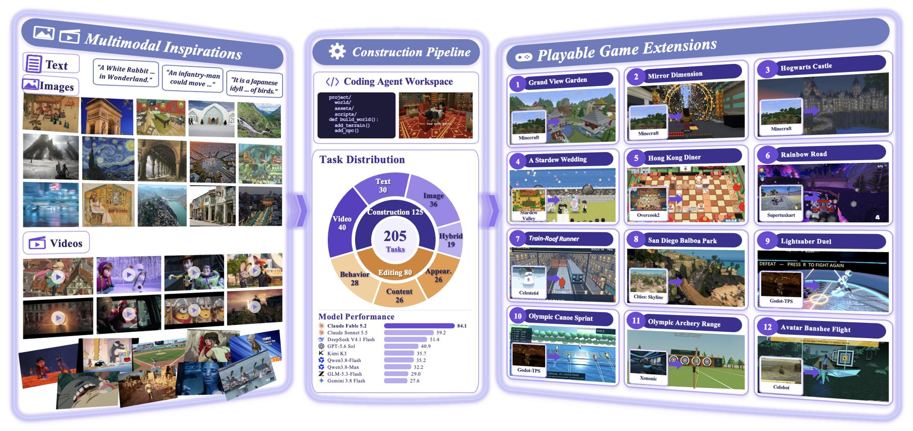</p>

GameAnything-Bench is the benchmark of *GameAnything: From Any Inspirations to Playable Game Worlds*. A coding agent gets a
reference (a video clip, a text, a set of images, or a mix) and the development kit of a real game, and must build a mod
that brings the reference into the game (**Construction**) or change a finished mod as asked without breaking the rest
(**Editing**). Every hand-in is built, replayed and played in a fresh sandbox, and a judge scores it against task-specific
rubrics.

## 📰 News

- **2026.11** Code, tasks and data released.

## Benchmark at a glance

<p align="center">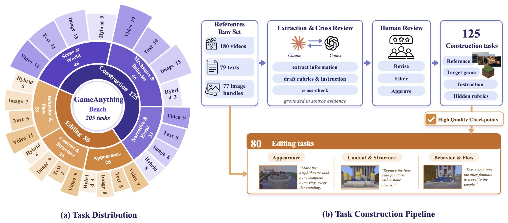</p>

| | Tasks | What the agent does | Scored on |
|---|---|---|---|
| **Construction** | 125 (40 video · 36 image · 30 text · 19 hybrid) | builds a mod from the reference | Content, Functions & Playability, Visual, Host fidelity |
| **Editing** | 80 (26 appearance · 26 content & structure · 28 behavior & flow) | changes a finished mod | Edit success, Preservation, Host fidelity |

**14 games**: 9 open source (the images are free to pull) and 5 commercial (you bring your own copy).

<table>
<tr>
<td align="center">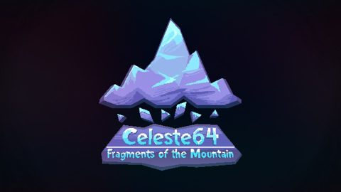<br><sub>Celeste 64</sub></td>
<td align="center">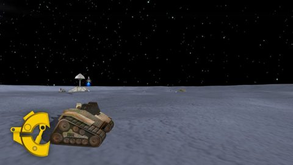<br><sub>Colobot</sub></td>
<td align="center">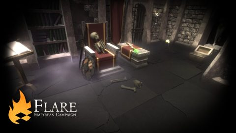<br><sub>Flare</sub></td>
<td align="center">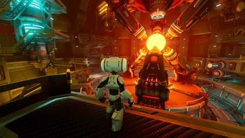<br><sub>Godot TPS</sub></td>
<td align="center">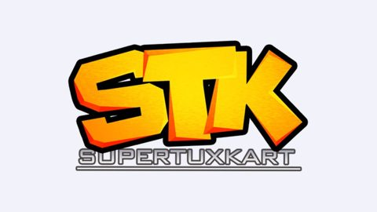<br><sub>SuperTuxKart</sub></td>
</tr>
<tr>
<td align="center">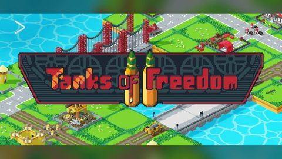<br><sub>Tanks of Freedom II</sub></td>
<td align="center">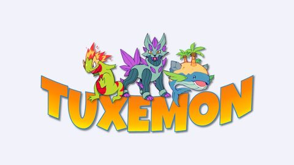<br><sub>Tuxemon</sub></td>
<td align="center">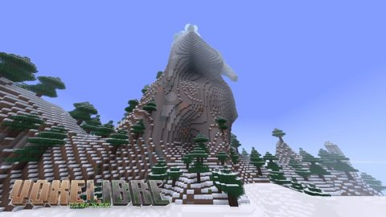<br><sub>VoxeLibre</sub></td>
<td align="center">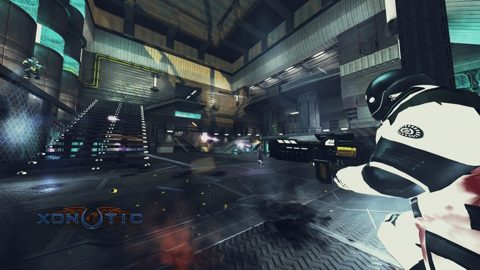<br><sub>Xonotic</sub></td>
<td align="center">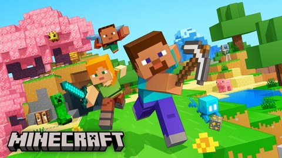<br><sub>Minecraft ★</sub></td>
</tr>
<tr>
<td align="center">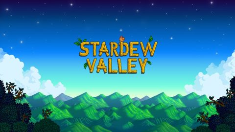<br><sub>Stardew Valley ★</sub></td>
<td align="center">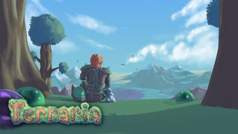<br><sub>Terraria ★</sub></td>
<td align="center">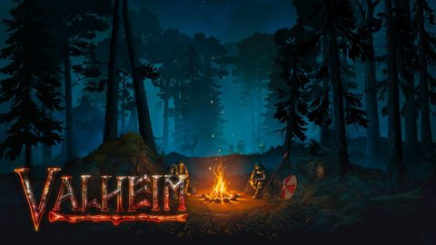<br><sub>Valheim ★</sub></td>
<td align="center"><br><sub>Cities: Skylines ★</sub></td>
<td></td>
</tr>
</table>
<p align="center"><sub>★ commercial game</sub></p>

## 🏆 Leaderboard

Native coding agents, one autonomous attempt per task (120 min for Construction, 60 min for Editing). Scores in %; $ C / $ E:
development cost in USD per Construction / Editing task.

| Model | Content | Func. | Visual | **Construction** | Edit Succ. | Pres. | **Editing** | $ C | $ E |
|---|---:|---:|---:|---:|---:|---:|---:|---:|---:|
| Claude Fable 5.2<br><sub>Claude Code</sub> | 85.9 | 82.9 | 80.1 | **84.1** | 87.4 | 98.7 | **86.5** | 5.96 | 1.63 |
| Claude Sonnet 5.5<br><sub>Claude Code</sub> | 59.4 | 56.8 | 50.4 | 59.2 | 74.4 | 95.4 | 72.8 | 1.84 | 0.53 |
| DeepSeek V4.1 Flash<br><sub>OpenCode</sub> | 49.7 | 48.4 | 45.2 | 51.4 | 71.4 | 95.6 | 69.9 | 0.26 | 0.11 |
| GPT-5.6 Sol<br><sub>Codex CLI</sub> | 39.2 | 34.7 | 38.5 | 40.9 | 74.3 | 95.0 | 72.5 | 2.55 | 2.13 |
| Kimi K3<br><sub>OpenCode</sub> | 34.4 | 29.7 | 30.0 | 35.7 | 69.4 | 95.8 | 67.7 | 5.48 | 2.62 |
| Qwen3.8-Flash<br><sub>OpenCode</sub> | 31.9 | 27.2 | 32.2 | 35.2 | 62.8 | 94.5 | 61.7 | 0.35 | 0.15 |
| Qwen3.8-Max<br><sub>OpenCode</sub> | 29.6 | 22.4 | 29.9 | 32.2 | 69.8 | 94.7 | 68.5 | 3.33 | 1.65 |
| GLM-5.3-Flash<br><sub>OpenCode</sub> | 25.7 | 19.6 | 26.2 | 29.0 | 64.7 | 96.1 | 63.4 | 0.52 | 0.19 |
| Gemini 3.8 Flash<br><sub>OpenCode</sub> | 23.3 | 16.5 | 26.5 | 27.6 | 62.6 | 95.6 | 61.3 | 2.65 | 2.42 |

Three rounds of +Ours refinement (critic review, revision, experience memory) raise Construction Overall by +10.5
(Sonnet 5.5), +7.6 (DeepSeek V4.1 Flash) and +14.8 points (Qwen3.8-Flash). Per-game results and the refinement study are
in the paper.

## 🚀 Quick start

Needs Linux, Docker, `ffmpeg` and Python ≥ 3.11.

```bash
git clone https://github.com/AetherLabsAI/GameAnything-Bench.git && cd GameAnything-Bench
uv venv && source .venv/bin/activate && uv pip install -e .     # or: python -m venv .venv && pip install -e .

gab setup                        # checks docker, GPU, the judge and disk space
gab get-game open                # the 9 open-source games (docker images, about 25 GB)
gab media fetch --track open     # references, editing checkpoints, target pictures (sha256 checked)
claude login                     # the judge: Claude Code CLI (or export ANTHROPIC_API_KEY=...)
```

Run one task first, then the whole benchmark:

```bash
export OPENROUTER_API_KEY=...    # the key of the model you test
gab bench --name my-agent --agent opencode --model deepseek/deepseek-v4.1-flash \
    --base-url https://openrouter.ai/api/v1 --api-key-env OPENROUTER_API_KEY \
    --agent-in-container --task T-IO-43b34cf1fa --edit E-T-IO-43b34cf1fa.AP

gab bench --name my-agent ... --track open      # all open-source tasks; run it again to resume
```

`gab bench` runs generation, evaluation and scoring, and writes `runs/my-agent/report/main_table.md` in the leaderboard's
format:

```
| Track | C: Content | C: Func. | C: Vis. | C: Pres. | C: Overall | C: Cost ($) | E: Overall | ...
|-------|------------|----------|---------|----------|------------|-------------|------------|
| open  | 66.7       | 35.7     | 50.0    | 0.0      | 45.7       | 0.11        | --         |
```

## ⚖️ Evaluation

Every hand-in first passes a **gate**: the mod builds, loads, runs stably and leaves the game itself working. Otherwise all
scores are 0. A judge (Claude Sonnet 5.5) then scores the rubric items.

| | What it does | Per submission | Error vs. humans |
|---|---|---|---|
| **Full** (default) | replays the agent's own input traces **and** lets an independent judge agent play the build; a third call settles disagreements | ~$0.56, ~13 min | 8.8 points |
| **Lite** (`--lite`) | replays the traces only and judges from their screenshots and game state | ~$0.20, ~6 min | 9.8 points, slightly harsher |

**Construction** Overall = 0.3 Content + 0.3 Functions + 0.3 Visual + 0.1 Host fidelity.
**Editing** Overall = E × [1 − 0.4 (1 − P) − 0.1 (1 − H)], with E = Edit success, P = Preservation, H = Host fidelity. Details in
[docs/evaluation.md](docs/evaluation.md).

## 🛠️ Options

<details>
<summary><b>Time budget</b>: <code>--minutes</code>, <code>--edit-minutes</code></summary>

The agent gets 120 minutes per Construction task and 60 per Editing task, as in the paper. `--minutes 30` is handy for a
quick end-to-end check; scores from a shorter budget are not comparable with the leaderboard.
</details>

<details>
<summary><b>Where the agent runs</b>: <code>--agent-in-container</code> (recommended)</summary>

| | Agent harness runs | Model key | Network in the trial |
|---|---|---|---|
| default | on your machine, driving the game through gab's `game` tool | in your shell | — |
| `--agent-in-container` (the paper's setting) | inside the trial container, seeing only that trial's files | stays on the host; a proxy adds it and enforces cost caps | none |

`--agent-in-container` needs Linux Docker Engine (on Docker Desktop, run gab inside WSL 2). Codex and OpenCode need
`--base-url` and `--api-key-env`; Claude Code uses your subscription token (`claude setup-token`) or
`--auth api --api-key-env VAR`. See [docker/README.md](docker/README.md).
</details>

<details>
<summary><b>Agents and credentials</b></summary>

gab never stores, prints or copies a key into a game container: you name an environment variable and gab reads it.

| For | Needs |
|---|---|
| the judge (always) | Claude Code CLI: `claude login`, or `ANTHROPIC_API_KEY` |
| `--agent claude` | Claude Code CLI, same login or key |
| `--agent codex` | Codex CLI: `codex login`, or `--base-url URL --api-key-env VAR` (Responses API) |
| `--agent opencode` | OpenCode with any OpenAI-compatible endpoint: `--base-url URL --api-key-env VAR` |
| `--agent-cmd "..."` | your own agent (see below) |
| `gab refine` (+Ours) | a vision model for the critic, `OPENROUTER_API_KEY` by default; change it with `gab setup --set critic_model <id>` |
</details>

<details>
<summary><b>Asset generation tools</b> (optional)</summary>

Agents can generate images (`gen-image`, OpenRouter by default, `OPENROUTER_API_KEY`), 3D models (`gen-3d`, Meshy,
`MESHY_API_KEY`) and sound (`gen-sfx` / `gen-music`, any `/audio/speech` API). A tool whose key is missing is switched off
and the agent is told so; agents without generated art **may score lower**, since the paper's runs had all of them.
Config keys: `image_base_url`, `image_key_env`, `image_model`, `audio_base_url`, ... (`gab setup --set KEY VALUE`).
</details>

<details>
<summary><b>Commercial games</b></summary>

`gab get-game commercial` sets up your own copies: Minecraft from the official servers (no login), Stardew Valley through
SteamCMD, Terraria, Valheim and Cities: Skylines through a Steam container that keeps your login (`gab steam login`; you
type your password and Steam Guard code yourself). Game files are mounted read-only and never put into an image.
See [docs/commercial_games.md](docs/commercial_games.md). `--track open` skips them.
</details>

<details>
<summary><b>Hardware</b></summary>

- One trial = one container. About 2 GB RAM and 2 cores per trial plus the game's needs; `gab bench` shows a parallel plan
  for your machine before it starts (`--plan` to only print it, `--workers N` to cap it).
- An NVIDIA GPU with the NVIDIA container toolkit for the 3D games (2 trials per GPU by default); without one they run in
  software OpenGL, slowly.
- Disk: about 25 GB for the open-source images, 30–60 GB more for the commercial games, a few hundred MB per trial.
</details>

<details>
<summary><b>Outputs</b></summary>

```
runs/<name>/
  <task>/fine/          one Construction trial: work/ (what the agent saw and built), agent/ (transcript, cost),
                        deliverable/ (the frozen hand-in), eval/ (evidence and verdicts), result.json (Full) / result@lite.json
  <edit>/edit/          one Editing trial, result@edit.json
  report/               main_table.md, summary.json, per-task CSVs
```

`gab score --name NAME` rebuilds a report; `gab table --names a,b` compares runs. Data lives in `~/.gab/` by default
(`gab setup --data DIR`).
</details>

<details>
<summary><b>Your own agent</b></summary>

```bash
gab bench --name mine --agent-cmd "my_agent --brief {brief} --refs {refs} --out {out}"
```

Your program gets the brief, the reference files and a `game` tool on its PATH (build, start, screenshots, input, replays),
and is stopped at the time budget. Placeholders, the hand-in format and cost reporting:
[docs/adding_an_agent.md](docs/adding_an_agent.md). `--agent stub` checks the pipeline without calling a model.
</details>

## 🔁 Reproducing the paper

```bash
bash scripts/reproduce_paper.sh                              # all 9 configurations, Construction + Editing
CONFIGS="dsv41flash-opencode" TRACK=open bash scripts/reproduce_paper.sh
```

| Configuration | Harness | Refinement rounds |
|---|---|---|
| Claude Fable 5.2 | Claude Code | — |
| Claude Sonnet 5.5 | Claude Code | R1–R3 |
| GPT-5.6 Sol | Codex CLI | R1 |
| DeepSeek V4.1 Flash, Qwen3.8-Flash | OpenCode | R1–R3 |
| Gemini 3.8 Flash, GLM-5.3-Flash, Qwen3.8-Max, Kimi K3 | OpenCode | R1 |

The script runs agents inside their containers and evaluates with Full (`EVAL=lite` for Lite). Paper ablations:
`gab run --no-reference`, `gab run --drop-modality KIND`, `gab refine --ablation nomem|nocritic|full`.

## 📚 Docs

[Framework](docs/SPEC.md) · [Evaluation](docs/evaluation.md) · [Commercial games](docs/commercial_games.md) ·
[Adding an agent](docs/adding_an_agent.md) · [Adding a game](docs/adding_a_game.md) ·
[Docker images and sandbox](docker/README.md) · `pytest` runs the tests (no game, docker or model needed).

## 🤝 Contributing

GameAnything is an open project, and we warmly welcome contributions from players, game designers, modders and
researchers. There are two ways to join:

| | [**Try GameAnything**](https://huggingface.co/spaces/GameAnything/GameAnything-Trial) | [**Contribute Tasks**](https://huggingface.co/spaces/GameAnything/gameanything-submit) |
|---|---|---|
| **For** | anyone who wants to use the platform | anyone with a game idea and a reference for it |
| **You share** | the games you play, the mods you have made, and one idea you would like to build (about 3 minutes) | a reference, a target game, a request and scoring points (about 10 minutes, no coding) |
| **You get** | free trial access, if selected | credit in the paper: thanks by name for 5 accepted tasks, authorship for a complete game package plus 10 accepted tasks |

Accepted tasks join the released benchmark under CC BY 4.0, with the name you choose. The submission page shows complete
examples, and the paper's *Call for Contributions* appendix lists the standards.

Code is welcome too: new agents, games and fixes, as pull requests to
[GameAnything](https://github.com/AetherLabsAI/GameAnything) or
[GameAnything-Bench](https://github.com/AetherLabsAI/GameAnything-Bench). For questions, open an issue or email
[wew058@ucsd.edu](mailto:wew058@ucsd.edu).

## Citation

```bibtex
@misc{wu2026gameanything,
  title  = {GameAnything: From Any Inspirations to Playable Game Worlds},
  author = {Wenyi Wu and Siqi Liu and Yuru Feng and Zixuan Song and Aayush Salvi and
            Sibo Zhu and Kun Zhou and Biwei Huang},
  year   = {2026},
  note   = {arXiv preprint, coming soon}
}
```

## License

Code: [Apache License 2.0](LICENSE). Third-party components in the docker images keep their own licences
([docker/LICENSES.md](docker/LICENSES.md)). The reference media in the dataset are for non-commercial research only and
keep their sources' rights.
